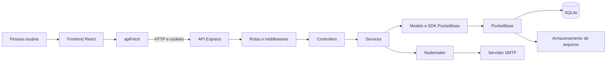

# Arquitetura do Sistema

Este documento descreve a estrutura atual da aplicação Tropa Livresca, suas tecnologias e o fluxo de comunicação entre o frontend, a API e os serviços de infraestrutura.

## Tecnologias

- **Frontend:** React 19, Vite 8 e React Router 7.
- **Backend:** Node.js 20 e Express 5, organizados em workspaces npm.
- **Persistência, autenticação e armazenamento:** PocketBase, com banco de dados SQLite, gerenciamento de usuários, autenticação e arquivos.
- **E-mail:** Nodemailer.
- **Empacotamento do backend:** esbuild, Node.js SEA e postject.
- **Execução portátil:** executáveis para Windows, com inicialização coordenada por arquivo BAT.
- **Testes de integração da API:** Jest, SWC e Supertest, conforme a configuração do projeto.

## Visão do Sistema

Os módulos funcionais do backend seguem uma arquitetura em camadas quando aplicável: as rotas conectam os endpoints aos middlewares e controllers; os controllers tratam o ciclo HTTP; os services coordenam as regras de negócio; e os models concentram as operações de acesso aos dados.

A infraestrutura compartilhada fica em `backend/src/api/common`.

## Backend

O ponto de entrada `backend/src/api.js` configura o servidor Express, incluindo CORS com credenciais, parsers JSON e URL-encoded, leitura de cookies, tratamento global de erros e disponibilização dos arquivos compilados do frontend no modo de produção.

A API organiza os grupos de rotas versionados:

| Prefixo           | Responsabilidade                                                                      |
| :---------------- | :------------------------------------------------------------------------------------ |
| `/api/v1/clients` | Funcionalidades da área de clientes, como livros, perfil, endereços e loja.           |
| `/api/v1/admin`   | Funcionalidades administrativas, incluindo livros, revisão, usuários e gerenciamento. |
| `/api/v1/auth`    | Autenticação e gerenciamento de sessão.                                               |

Os diretórios `backend/src/api/admin` e `backend/src/api/clients` agrupam os módulos de rotas por funcionalidade. Cada módulo pode conter arquivos `.route.js`, `.controller.js` e `.service.js`.

Os recursos compartilhados ficam em `backend/src/api/common`, organizados em diretórios como `auth`, `config`, `middlewares`, `models` e `utils`.

A comunicação com o PocketBase é realizada pelo SDK JavaScript, centralizado na infraestrutura compartilhada do backend. Os models e helpers responsáveis pela integração abstraem operações de consulta, autenticação e manipulação de arquivos.

## Frontend

O ponto de entrada `frontend/src/main.jsx` renderiza a aplicação, enquanto `App.jsx` organiza os provedores de contexto e a estrutura principal.

O roteador em `frontend/src/common/routes/RoutesApp.jsx` encaminha as páginas para as áreas administrativa, de autenticação e de clientes.

As funcionalidades são organizadas em `frontend/src/admin` e `frontend/src/clients`. Elementos compartilhados, configurações, contextos, hooks e serviços ficam em `frontend/src/common`.

O serviço `frontend/src/common/services/api.js` disponibiliza `apiFetch`, responsável pelas requisições HTTP à API. As chamadas incluem credenciais por meio de `credentials: "include"`, permitindo o envio dos cookies de autenticação.

Na versão portátil, o frontend compilado é servido pelo próprio backend Express, permitindo que a interface e a API sejam acessadas pela mesma origem.

##
